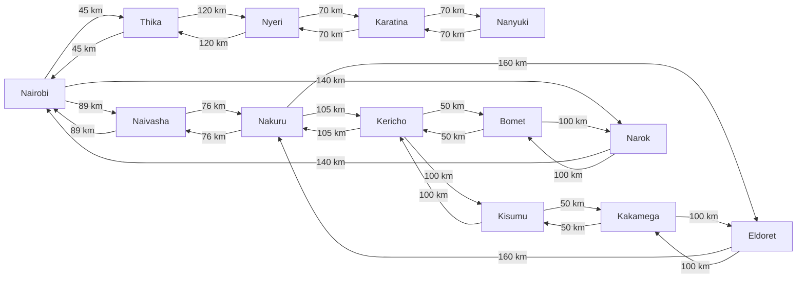

ICS 3202 Practical Exercise 3: Designing a Searching Agent

 Group Members
 Eeshah Sabir Khan  192089 
 Abdulle Abdullahi Faduma  191648 

Question 1: PEAS Framework and Environment Properties
### Agent description
The agent is a self-driving trailer that carries cargo along Kenya's highway network, for example from Nairobi to Kisumu, without a human driver.

### PEAS

| Component | Description |
|-----------|-------------|
| **Performance measure** | Reaching the destination with the cargo undamaged. Taking the shortest distance. Avoiding collisions. Obeying traffic rules and speed limits. Using fuel efficiently. Delivering on time. |
| **Environment** | Kenyan highways and the towns along them. Other vehicles such as cars, matatus and trucks. Pedestrians and animals on the road. Road signs, junctions and roundabouts. Weather (rain, fog). Road conditions like potholes and roadworks. Traffic police. |
| **Actuators** | Steering, accelerator, brakes, gear system, indicators, headlights, horn, windscreen wipers. |
| **Sensors** | Cameras, GPS, radar/lidar, ultrasonic sensors, speedometer, odometer, fuel gauge, rain sensor, cargo weight sensor. |

### Environment properties

| Property | Classification | Justification |
|----------|----------------|---------------|
| Observability | Partially observable | Information about the environment is not fully available to the trailer. Its sensors have limited range and can be noisy, so it cannot see around bends, hidden potholes or what other drivers will do. It must make informed guesses about the road ahead. |
| Determinism | Stochastic | The next state does not depend only on the current state and the trailer's action. Other drivers, weather, animals crossing and breakdowns are beyond the agent's control. |
| Episodic vs sequential | Sequential | The choice of action depends on previous actions. Earlier decisions on route, speed and fuel use affect what the trailer can do later in the trip. |
| Static vs dynamic | Dynamic | The environment keeps changing while the trailer is selecting an action, because other vehicles, pedestrians and traffic conditions are always moving. |
| Single vs multi-agent | Multi-agent | The trailer operates with other agents in the environment: other drivers, matatus, trucks, pedestrians and traffic police. |

## Question 2: Directed Graph and Search Tree
Towns and cities across the four regions:
Nairobi  |   Nairobi, Thika 
Central Highlands  |   Nyeri, Karatina, Nanyuki
Rift Valley  |   NNaivasha, Nakuru, Eldoret, Narok, Bomet 
Lake Victoria Basin  |   Kericho, Kakamega, Kisumu, Siaya

## ABSTRACTION: 
Each major town is represented as a node (state) and each highway link as a directed edge(action) weighted by driving distance in kms. two-way roads have edges in both directions , while minor roads, traffic, road conditions and other details are ignored as part of abstraction. the search stops at kisimu which is the goal state and avoids revisiting towns on the same branch to prevent any loops.

## DIRECTED GRAPH: 

## Question 3: Optimal Path from Nairobi to Kisumu
## working distances used for the route comparison.
From	 To	       Distance (km)
Nairobi	 Naivasha	89
Naivasha Nakuru	    76
Nakuru	 Kericho	105
Kericho	 Kisumu	    100
Nairobi	 Thika	    45
Thika	 Nyeri	    120
Nyeri	 Karatina	70
Karatina Nanyuki	70
Nakuru	 Eldoret	160
Eldoret	 Kakamega	100
Kakamega Kisumu	    50
Nairobi	 Narok	    140
Narok	 Bomet	    100
Bomet	 Kericho	50

## SEARCH ALGORITHM
The UCS is teh appropriate algorithm when the objective is to find a minimum-cost path and each edge has a non negative cost. 

It selects the frontier path with the lowest accumulated cost rather than the path with the fewest edges. 

## UCS FRONTIER SEQUENCE 
Step	Node expanded	Frontier after expansion (lowest cost first)
1	    Nairobi (0)	    Thika (45), Naivasha (89), Narok (140)
2	    Thika (45)	    Naivasha (89), Narok (140), Nyeri (165)
3	    Naivasha (89)	Narok (140), Nyeri (165), Nakuru (165)
4	    Narok (140)	    Nyeri (165), Nakuru (165), Bomet (240)
5	    Nyeri (165)	    Nakuru (165), Karatina (235), Bomet (240)
6	    Nakuru (165)	Karatina (235), Bomet (240), Kericho (270), Eldoret (325)
7	    Karatina (235)	Bomet (240), Kericho (270), Nanyuki (305), Eldoret (325)
8	    Bomet (240)	    Kericho (270), Nanyuki (305), Eldoret (325)
9	    Kericho (270)	Nanyuki (305), Eldoret (325), Kisumu (370)
10	    Nanyuki (305)	Eldoret (325), Kisumu (370)
11	    Eldoret (325)	Kisumu (370), Kakamega (425)
12	    Kisumu (370)	Goal reached; stop

## Final optimal path and total distance
The working graph gives the following minimum-cost path:
Nairobi -> Naivasha -> Nakuru -> Kericho -> Kisumu

Highway link	      Distance	    Cumulative cost
Nairobi -> Naivasha	  89 km	        89 km
Naivasha -> Nakuru	  76 km	        165 km
Nakuru -> Kericho	  105 km	    270 km
Kericho -> Kisumu	  100 km	    370 km

Total	                            370 km

 Teamwork Evidence
